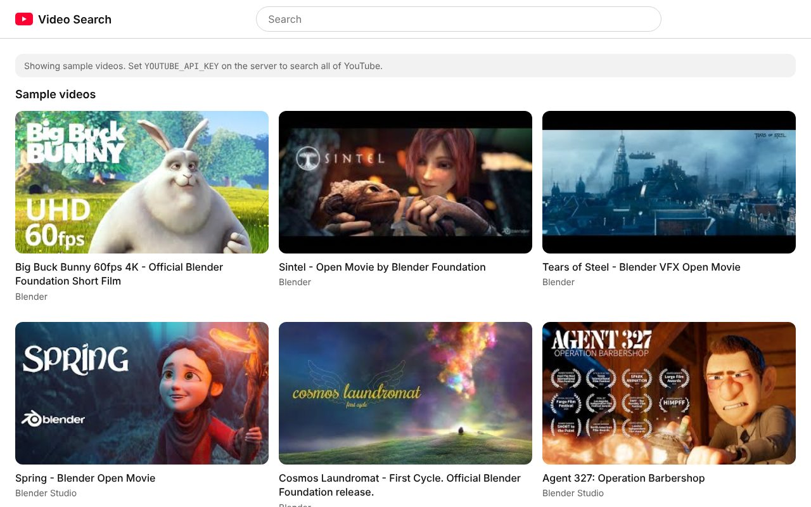
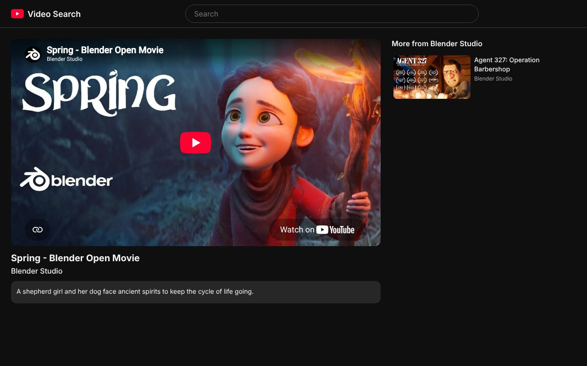
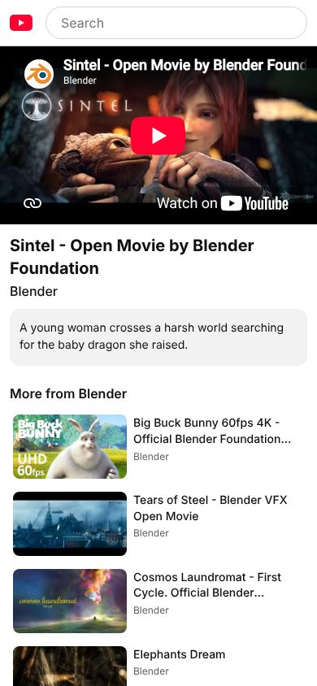

# YouTube React

Search YouTube and watch videos in a clean, fast player. Built with React and the
[YouTube Data API](https://developers.google.com/youtube/v3).

- Results update as you pause typing, with each video's length, views and age; what's popular
  shows before you search.
- Every video has its own page (`/watch/<id>`) with the player, views, likes, upload date, the
  full description, and more from the same channel.
- Searches and videos are real URLs, so they can be shared, bookmarked and reached with Back.
- Light and dark to match your system, works on phones, and <kbd>/</kbd> jumps to search.



| Watch page (dark)                         | Phone                                                |
| ----------------------------------------- | ---------------------------------------------------- |
|  |  |

Screenshots show the sample videos it uses until an API key is set.

Started in 2018 as a React course project; rebuilt on a current stack.

## Running it

Needs Node 24 and pnpm (`corepack enable` sets pnpm up).

```sh
pnpm install
cp .env.example .env   # then add your YOUTUBE_API_KEY
pnpm dev               # http://localhost:5173
```

Without a key, searches answer from a small set of sample videos (Blender's open movies, which
are real and play in the embedded player), and the page says so.

### Getting a YouTube API key

1. In the [Google Cloud console](https://console.cloud.google.com/), create a project and enable
   **YouTube Data API v3**.
2. Under **APIs & Services → Credentials**, create an API key. Restrict it to the YouTube Data
   API.
3. Put it in `.env` as `YOUTUBE_API_KEY`.

The key stays on the server: the browser only ever talks to this app's `/api`.

### Quota

The API allows 10,000 units a day. A search costs 101 (100 for the search, 1 for the lengths
and view counts of its results), so about 100 searches a day; everything else costs 1 or 2: the
popular list, a video's details, and a channel's uploads (read from its uploads playlist rather
than searched). To stretch that, the server:

- caches each search for an hour (video details for 10 minutes, channel lists for 30), and
  shares one request between visitors asking for the same thing at once;
- waits for a pause in typing before searching;
- limits each visitor to 30 requests a minute.

When the day's quota runs out, the page says so; it resets at midnight Pacific time.

## Production

```sh
pnpm build
YOUTUBE_API_KEY=... pnpm start   # http://localhost:8787 (PORT to change)
```

`pnpm start` runs the server (Hono on Node, which runs the TypeScript directly) and serves the
built app, with a strict Content Security Policy.

Or with Docker:

```sh
docker build -t youtube-react .
docker run -p 8787:8787 -e YOUTUBE_API_KEY=... youtube-react
```

The image runs as a non-root user and reports its health at `/api/health`.

## Development

```sh
pnpm test       # Vitest: app (Testing Library) and server
pnpm lint       # ESLint
pnpm format     # Prettier
pnpm typecheck  # TypeScript 7
```

`pnpm dev` runs the API inside Vite's dev server, so one command runs everything.

## Stack

React 19, TypeScript 7, Vite 8, TanStack Query, Hono, Vitest. Videos play through the
privacy-enhanced embed (`youtube-nocookie.com`), which sets no cookies until you press play.
